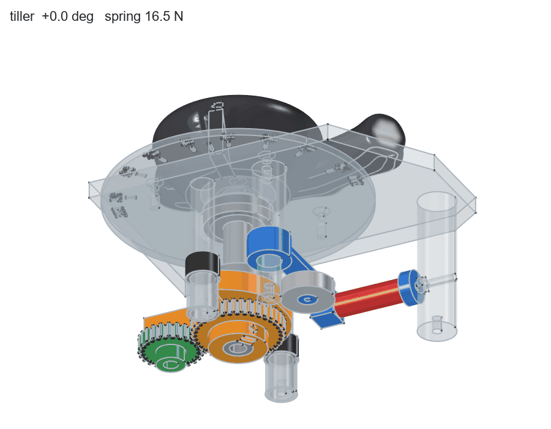
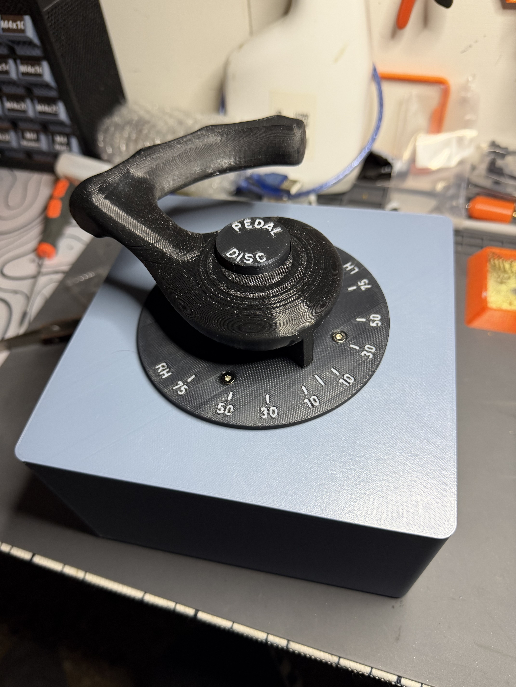

# MF A320 Tiller

A 3D-printed nosewheel steering tiller for the Airbus A319 / A320 / A321 in
Microsoft Flight Simulator 2024, set up for the Fenix A320. It has a
spring-centred handle with a felt centre and soft end stops, the PEDALS DISC
push-and-lock button in the handle, and a scale disc. Inside is an RP2040 board
that shows up in Windows as a plain USB game controller.

## How it works

- **Travel ±75°.** A V-shaped cam on the shaft pushes a 608ZZ roller on a
  pivoting arm, and a compression spring pushes the arm back. The cam profile
  is computed from the torque wanted at the handle:
  - a soft detent you feel at centre;
  - a gentle rise over the travel;
  - a warning ramp over the last 15°.

  The stop lug on the cam meets TPU bumpers at ±75°.
- **The shaft** turns in two 6001Z bearings in the chassis tower. The handle
  is held by a flange and 3 × M3 screws into heat-set inserts.
- **The sensor** is a B10K linear potentiometer, driven by a 36 : 24 gear pair.
  Its gear is pressed onto the knurled shaft. ±75° at the handle turns the pot
  225° of its ~270°.
- **PEDALS DISC** is a 7 × 7 self-locking switch under a printed cap in the
  handle. Its wires go down the hollow shaft.
- **The case** is 163 × 163 mm. The mechanism hangs under the case top, and the
  RP2040 sits in a printed cradle on the bottom with its USB-C through the back
  wall.

## Repository

| Folder | What |
|---|---|
| `cad/` | FreeCAD 1.1 part files (PartDesign bodies, sizes on a **Params** sheet in each file) and `Tiller.FCStd`, the whole assembly as links |
| `stl/` | Print files, one per part |
| `firmware/` | RP2040 firmware (arduino-pico): the sketch, a ready-built `.uf2`, wiring and calibration |
| `docs/assembly.md` | The full build notes: design decisions, every part with its sizes, bought parts, printing, assembly steps, open points |
| `tools/freecad/` | Scripts used while designing: the mechanism and case generator, the cam synthesis, an interference check over the travel, the animation above |

The FCStd files are the master: open them in FreeCAD and change what you like.

## Printing

| Material | Parts |
|---|---|
| PETG | Handle, Shaft, Chassis, Rotor, RollerArm, Deck, PotGear, SpringCup (100 % infill), StopSpacer × 2 |
| PLA | CaseShell, CaseBottom, ScaleDisc (+ legend inlay), ButtonBase, ButtonCap (+ legend inlay) |
| TPU | Bumper × 2, Foot × 4 |

`FitTest` (PETG) and `FitTestPLA` are small test plates for bearing seats,
insert holes and the board cradle. Print them first if your printer's
tolerances differ. Orientation and notes for each part are in
`docs/assembly.md`.

## Bought parts

- 2 × ball bearing 6001Z (12 × 28 × 8) and 1 × 608ZZ (8 × 22 × 7)
- Compression spring 1 × 10 × 40 (wire 1, OD 10, free length 40), about 1.6 N/mm
- Linear rotary potentiometer B10K, M7 bushing, knurled split shaft
- 7 × 7 self-locking push switch
- RP2040 board, Raspberry Pi Pico form factor, and a USB-C cable
- 15 × M3 heat-set inserts, M3 nuts and screws (exact list with lengths in
  `docs/assembly.md`), 1 × M3 washer DIN 9021

## Wiring

| From | RP2040 (Pico pin) |
|---|---|
| Pot, outer pin | 3V3 OUT (36) |
| Pot, other outer pin | AGND (33) |
| Pot, wiper (middle pin) | GP26 / ADC0 (31) |
| PEDALS DISC switch | GP2 (4) and GND (3) |

## Firmware and calibration

1. Hold BOOTSEL and plug the board in.
2. Copy `firmware/bin/Airbus_Tiller_RP2040.uf2` onto the RPI-RP2 drive.

The board restarts as **Airbus Tiller**, a game controller with one axis and
one button.

Calibration runs over the USB serial port at 115200 baud:

| Command | Handle position | What it does |
|---|---|---|
| `c` | released at centre | records the centre |
| `l` | held at the left stop | records full left |
| `r` | held at the right stop | records full right |
| `w` | | writes the calibration to flash |

`d <0…200>` sets the dead band round the centre, in per mille of half travel.
See `firmware/README.md` for the details.

## In the simulator (Fenix A320)

- **Tiller.** In the MSFS 2024 controls, bind Airbus Tiller axis X to
  **Nose Wheel Steering Axis**.
- **PEDALS DISC.** In MobiFlight, add an input on the joystick Airbus Tiller,
  button 1:
  - on press, set `L:S_FC_CAPT_TILLER_PEDAL_DISCONNECT` to 1;
  - on release, set it to 0.

## License

GNU General Public License v3.0, see [LICENSE](LICENSE).
